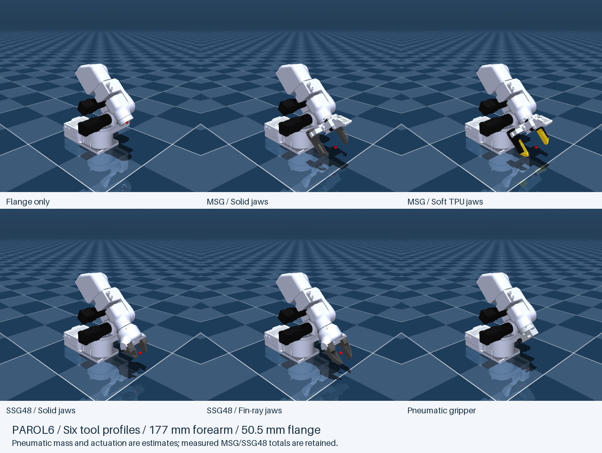

# Source Robotics robot descriptions

This repository contains independently portable PAR6 and PAROL6 model distributions,
each in URDF and MuJoCo formats.
Choose the format required by the target simulator; do not upload the entire
repository when the viewer asks for one robot package.

Download the [tested model packages](https://github.com/Source-Robotics/robot_descriptions/releases/latest)
for direct use. To maintain or embed these models, see [the build guide](BUILDING.md)
and [release/submodule instructions](RELEASING.md).

Every package includes `docs/DH.md` and `KINEMATICS_COMPARISON.md`, documenting
its coordinate convention and the differences between the two robot families.
It also includes `docs/KINEMATIC_REVIEW.md` and dimensioned SVG/PNG sheets with a
tool-specific DH table for each profile. Open the
[offline comparison page](reports/kinematics_review/index.html) to compare any
two configurations, or the [printable booklet](output/pdf/robot_kinematics_review.pdf)
for all twelve sheets. See [the numerical review](reports/kinematics_review/README.md)
for the model-derived dimensions and checks.

## Independent checkout and authoring

Version **2.12.1** builds from this repository alone. See [BUILDING.md](BUILDING.md)
for the locked Python environment and `python tools/build.py`. The build uses
versioned reference data and needs no local IK, RCB runtime or motion app.
A GitHub Actions workflow is included for the same standalone tests and full
build. The [2.8.1 portability validation](reports/standalone_build_validation.md)
records the earlier standalone-workflow checks; the
[2.9.0 PAROL6 validation](reports/parol6_build_validation.md) records that
earlier release. The [frame-normalization validation](reports/parol6_frame_normalization_validation.md)
records the common-coordinate build before the review documentation update.

## PAROL6 and the PAR6 frame comparison

PAROL6 uses the included user-supplied arm export, with PAR6's shared physical
properties and all six tool profiles. Its J1-J3 motor/gearbox meshes are black;
its original complete arm collision meshes remain intact. PAR6 artwork is not
applied to PAROL6.

| Robot | MuJoCo package | URDF package |
| --- | --- | --- |
| PAR6 | `mujoco/par6` | `urdf/par6_description` |
| PAROL6 | `mujoco/parol6` | `urdf/parol6_description` |

Read [the DH and frame comparison](reports/par6_parol6_kinematics.md) for the
common 177 mm forearm, joint-angle directions and corrected wrist flange adapter.
That document and its diagram are included in all four portable packages.
PAROL6 now uses PAR6's public joint directions and origin orientations,
including J6. Both use d4 = -177 mm. Flange-ending d6 differs: PAR6 -57.1 mm,
PAROL6 -50.5 mm, matching housing-to-tool spacing against the shorter wrist.
PAROL6's lower-arm visual/collision origins and wrist origin move outward
0.65 mm from the old export. Every tool and TCP moves 6.6 mm toward J6;
flange-relative tool definitions and inherited local inertials stay intact.
The old supplied export is retained unchanged for reference; its reversed
coordinate directions are a historical conversion, not the new public model.
A physical controller's encoder/homing mapping is not inferred from the model.
See `docs/ACTUATION.md` in each package for finite servo settings and the distinction
between open-loop hardware and simulated joint stiffness.



The build writes four ZIPs under `dist/`: `par6_mujoco.zip`, `par6_urdf.zip`,
`parol6_mujoco.zip` and `parol6_urdf.zip`.

## Pneumatic gripper

The original side-gripping pneumatic assembly is available on both arms as
`pneumatic`. Open `scene_pneumatic.xml` in either MuJoCo package, or load
`par6_pneumatic.urdf` / `parol6_pneumatic.urdf`. Jaws move symmetrically through
3.5 mm each, with native coupling, URDF mimic joints and convex collisions.
Its legacy 195 g total, CAD mass distribution and finite actuator settings
remain estimates. See [PNEUMATIC.md](mujoco/par6/docs/PNEUMATIC.md) for mounting,
TCPs, open/close controls and calibration status. Existing measured electric
gripper masses and the five earlier profiles are retained.

## J1, J2 and J3 actuator appearance

The three motor/gearbox assemblies have separate black visual meshes and
independent materials, `j1_actuator_black`, `j2_actuator_black`, and
`j3_actuator_black`. The surrounding structure retains its original color.
This applies to the flange, MSG, and SSG48 variants in both distributions.

The original complete STLs remain the collision meshes. No links, bodies,
joints, frames, limits, actuators, mass, center of mass, or inertia were changed.
MJCF's added visual geoms have zero mass and disabled collisions; the affected
original collision geoms have transparent rendering. URDF changes are confined
to the affected links' visual elements.

See [the appearance preview](docs/images/motor_visuals_preview.png), the reproducible
[mesh partition script](tools/split_motor_visuals.py), and
[validation results](tools/motor_visual_validation.json). Every source triangle
record is preserved exactly across the visual partitions. Each package's own
original STL is used, preserving its existing vertex order and normals.

## MSG gripper appearance

The MSG camera lens barrel and gripper motor have separate black visuals and
independent `msg_camera_lens_black` and `msg_gripper_motor_black` materials.
The camera enclosure, printed brackets, rails, and other gripper parts keep
their previous colors. The original complete gripper mesh remains the collision
shape, and the camera pose, intrinsics, gripper mechanism, and inertial data are
unchanged. See [the gripper preview](docs/images/gripper_visuals_preview.png).

Visual partitions are in `mujoco/par6/assets/visual/` and, for the URDF MSG
variant, `urdf/par6_description/meshes/msg/visual/`.

Earlier [visual performance measurements](tools/visual_performance.json)
refer to the appearance-only update before the badge and contact refinement.
Current contact timing is recorded separately under `reports/`.

## Jaw options

| Gripper | Default | Other option |
| --- | --- | --- |
| MSG | Solid jaws | Soft TPU jaws |
| SSG48 | Solid jaws | Fin-ray jaws |

Soft TPU jaws have yellow honeycomb inserts and black holders/carriages.
SSG48 Solid jaws use the supplied `solid_jaws_pinch.STEP`; the checked surface
deviation from the matching export is below 0.055 mm. Their tip is 31.0 mm
from the mounting plane, versus 54.4 mm for Fin-ray jaws: reach is 23.4 mm shorter.

All options keep the existing finger joints, travel, coupling, drive settings,
camera and TCP. Measured tool masses are applied in version 2.8.0; tool COM and inertia remain
existing estimates. Equal mass
does not establish equal COM or inertia when a jaw's shape changes.

In `par6_motion`, the panel's **Tool and jaws** selector loads any of the five
setups, including Flange only. **Load setup** stops motion, saves the current
recording, and starts a new simulation session at the measured arm joint pose.
Controls, taught points, paths and jaw opening reset with the new session.
The configured Haply/UDP input reconnects; following must be enabled again.
Command-line examples:

```bash
python tools/jog_cartesian.py --haply --msg-jaws solid
python tools/jog_cartesian.py --haply --msg-jaws soft-tpu
python tools/jog_cartesian.py --variant ssg48 --haply --ssg48-jaws solid
python tools/jog_cartesian.py --variant ssg48 --haply --ssg48-jaws fin-ray
```

Old flag values (`stock`, `tpu-glue`, `pinch`) and model filenames remain valid
for compatibility. Python accepts the new names too, for example
`MujocoTwin('msg', msg_jaws='soft-tpu')`.

## Finger contacts and grasp checks

Each finger now uses six hidden convex collision pieces fitted through the
selected external carriage/jaw mesh. SSG48 internal transmission racks remain
visual-only; both formats share the native external contact envelope. The pieces preserve the original
surface envelope and reduce the empty space filled by a single convex hull.
The contact refinement itself preserves visible meshes and inertial definitions.
The separate version 2.8.0 update synchronizes inertia and measured masses. There are no
new bodies or joints. Contacts intentionally differ from the old single hull.
Small honeycomb holes, TPU deformation and Fin-ray flex are not simulated.

The native package includes `bench/`: four profiles, each with a 50 g box and
cylinder. From the description repository root, run:

```bash
python tools/grasp_check.py --all
python tools/grasp_check.py --profile ssg48-solid --shape box --view
```

The check closes, lifts 50 mm, holds and releases. All eight cases per robot
meet the 35 mm retained-lift and 25 mm release-drop thresholds. Objects keep
50 g mass and are shortened where needed to leave 5 mm housing clearance;
SSG48 Solid jaws use a 41.2 mm object rather than the former overlapping
60 mm fixture. Its box retains about 37.3 mm of lift. Force, friction and
pass thresholds are unchanged. See [SSG48 contact diagnosis](reports/ssg48_contact_diagnosis.md)
for internal rack filtering and the fixture correction. These checks do not
establish measured hardware grip force or compliance. The command returns a
nonzero exit status when any case misses its threshold.

## Rebuilding jaws

Editable sources are `source/jaws/msg_tpu_glue/jaw.json` (black/yellow palette
and mounting transform) and `source/jaws/ssg48_pinch/jaw.json` (Solid jaws color
and source alignment). Run `python tools/build_msg_jaws.py` or
`python tools/build_ssg48_jaws.py` from this description directory. Builders
refresh contact pieces and grasp fixtures after rebuilding the selected jaws.
Build dependencies include numpy, scipy, trimesh, gmsh, vhacdx and mujoco;
exported models do not require the CAD conversion tools.

See [contact geometry](reports/gripper_contact_geometry.json),
[contact-refinement validation before the inertia synchronization](reports/gripper_contact_validation.json),
[grasp results](reports/grasp_checks.json), and
[local timing measurements](reports/gripper_contact_performance.md).
The older timing reports under `tools/` describe earlier package versions.

## Synchronized dynamics in version 2.8.0

Both formats now use RCB's five arm link masses, COM and central inertia,
converted into their existing CAD body frames. The measured flange mass is
55.5 g; MSG is 380 g (301.4 g fixed + two 39.3 g moving assemblies); SSG48 is
440 g (361.4 g fixed + two 39.3 g moving assemblies). All five jaw/tool variants
use these targets. Source measurements and policies are under `source/dynamics/`.

See the [synchronization results and remaining estimates](reports/dynamics_sync_validation.md),
[detailed validation](reports/dynamics_sync_validation.json), and
[whole-model comparison](reports/rcb_model_comparison.md). The arm-only check
covers 160 poses per variant. Geometry, kinematics, collisions, limits and
actuator settings are unchanged.

Gripper COM and central inertia remain the existing unverified estimates;
motor rotor/armature values are explicitly deferred, and fixed-base properties
are unchanged. The working RCB runtime files remain read-only, including its
older configured tool masses. Therefore whole-model dynamics do not yet fully
match. The [action plan](reports/dynamics_alignment_plan.md) records what remains.

Run `python tools/build.py` for the complete standalone build, or
`python tools/sync_model_dynamics.py` to regenerate arm properties and tool
masses from their references. This also rebuilds grasp fixtures. The jaw
builders call the same synchronization so color/geometry rebuilds preserve it.
Use `python tools/audit_rcb_dynamics.py` for the whole-model comparison and
`python tools/package_models.py` to rebuild and check the portable ZIPs.

For a calibrated gripping reference distinct from the retained control TCP,
see [the grasp-frame proposal](reports/grasp_frames.md).

## Names and logos

Multicolor text and logos can be added as visual-only decals on an existing
link/body. For MuJoCo, use a PNG texture with a UV-mapped OBJ mesh. For URDF,
a textured DAE mesh with PNG artwork is a practical option; exact support
depends on the viewer. SVG artwork can be rasterized to PNG or converted into
separate colored mesh shapes. JPG artwork can be converted to PNG for a shared
asset workflow. The current STL meshes have no UV coordinates.

The supplied Source Robotics / PAR6 / Collaborative SVG is now fitted to the
flat outer cover of `upper_arm_link`, on the side shown in the placement
reference. It follows the panel's long axis, with the emblem toward the elbow.
See [the side-badge preview](docs/images/side_badge_preview.png).

The badge is now a 1024x384 RGB PNG painted onto the existing cover visual,
using a UV-mapped OBJ in MJCF and a textured DAE in URDF. It replaces the
previous seven thin meshes and 9,916 extra triangles. No badge geoms, links,
bodies, or triangles are added. The original collision STLs and all physical
definitions remain unchanged. The cover's original displayed normals are
preserved, including MuJoCo 3.3's sharp-edge normal fallback.

To change the background, emblem, symbol, wordmark, robot name, tagline, or
divider color, edit the seven `colors` entries in
[`source/artwork/par6_side_badge.json`](source/artwork/par6_side_badge.json)
and run `python tools/build_side_badge.py` from this description directory.
The `texture_width_px` and `texture_height_px` settings control image resolution.
Rebuilding updates all three variants in both formats. Colors are baked into
the PNG; individual badge elements no longer use separate runtime materials.
The original SVG is preserved beside the configuration and bundled with the
generated cover and PNG in each package's `branding/` mesh directory. The
builder checks that the artwork remains inside the panel's flat face.

The [optimized badge timing comparison](tools/side_badge_optimization_performance.json)
used nine interleaved batches of 50 frames with the badge-facing view at
1280x720. Median frame times were 5.60 ms for the previous seven-mesh badge,
5.30 ms for the textured cover, and 5.31 ms without a badge. The new version's
cost was within this test's observed variation. These local offscreen timings
include scene updates and RGB readback; they do not measure GUI presentation
or Haply end-to-end latency. That appearance-only version retained 10 collision
geoms and 36 clearance pairs. Version 2.7.0 refines finger contacts separately;
see the current contact validation and performance reports above.

## Ready-to-use packages

### MuJoCo / MJCF

Use [`mujoco/par6`](mujoco/par6/). It follows the MuJoCo Menagerie convention:
entry scenes and robot definitions at the package root, one shared `assets/`
directory, plus README, licence, changelog, previews, and Sim2Bot metadata.

Available entries:

- `scene_flange.xml`
- `scene_msg.xml` (also the default `scene.xml`)
- `scene_msg_tpu_glue.xml` (Soft TPU jaws)
- `scene_ssg48.xml` (Solid jaws, default)
- `scene_ssg48_stock.xml` (Fin-ray jaws)

### URDF / ROS

Use [`urdf/par6_description`](urdf/par6_description/). It is both a ROS 1
description package and a portable folder for viewers that accept relative mesh
paths.

Available entries:

- `par6_flange.urdf`
- `par6_msg.urdf`
- `par6_msg_tpu_glue.urdf` (Soft TPU jaws)
- `par6_ssg48.urdf` (Solid jaws, default)
- `par6_ssg48_stock.urdf` (Fin-ray jaws)

The entries share `meshes/common/` and keep only end-effector-specific
geometry in separate mesh directories.

## Sim2Bot variants

Both packages contain `sim2bot.robot.json`. Drop either package folder or ZIP
into Sim2Bot and choose **Flange only**, **MSG - Solid jaws**, **MSG - Soft TPU jaws**, **SSG48 - Solid jaws**, or **SSG48 - Fin-ray jaws** in
the import review step.

The MuJoCo MSG variant includes its fixed `msg_camera`; the flange and SSG48
variants do not. In package 2.0, `wrist_3_link` is the exact DH frame-6 link,
`flange` is the physical mounting face, and `tcp` remains the selected tool's
operational frame.

## Original exports

`source/legacy/` preserves the original SolidWorks-generated ROS packages,
MJCF files, CSV/export logs, jaw alternatives, images, PDF, and notes. It is
retained for provenance and is not part of either runtime distribution.

## Physical-data warning

The original URDF export supplied zero placeholder joint limits, efforts, and
velocities. Portable URDF entries therefore represent the six arm axes as
continuous for visualization and import testing. Those values must be replaced
with manufacturer-verified PAR6 specifications before hardware control or
safety/dynamics analysis.
