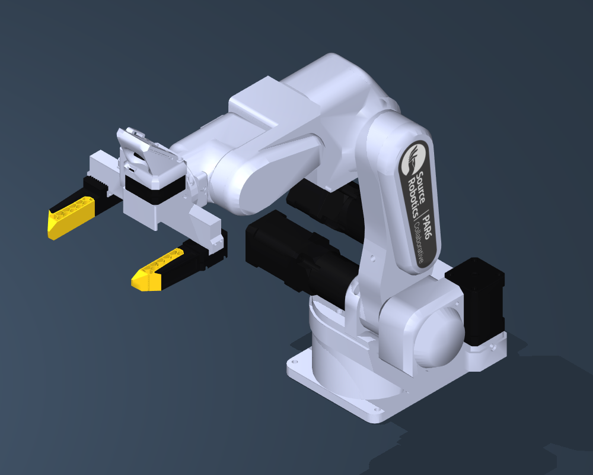
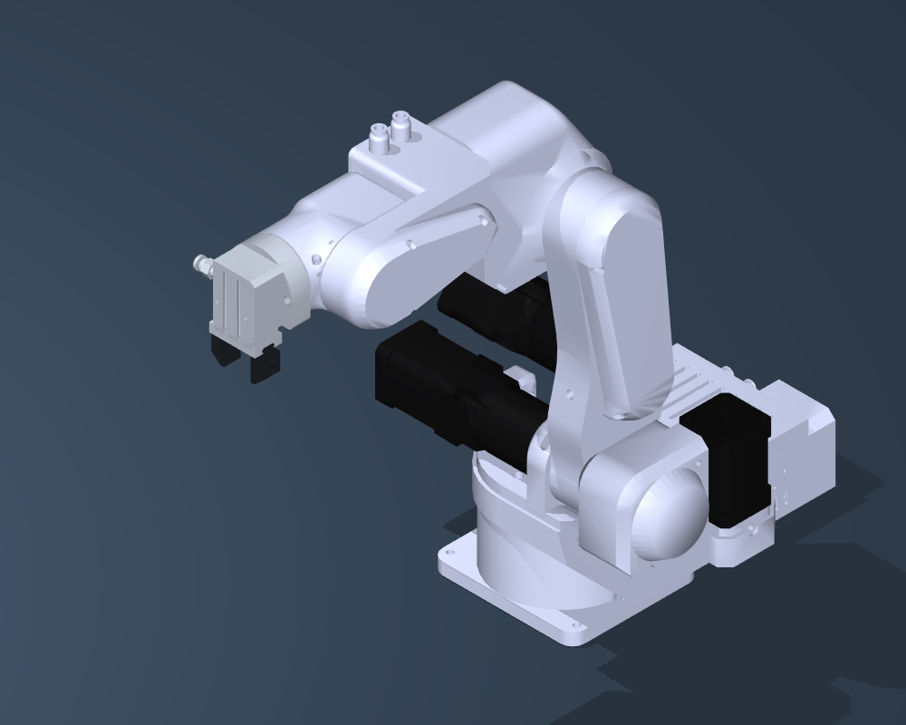
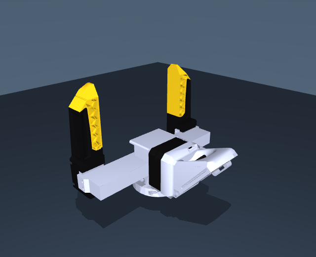
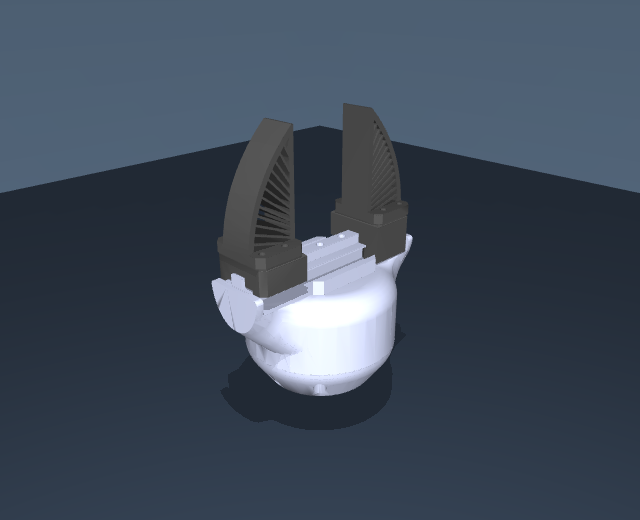
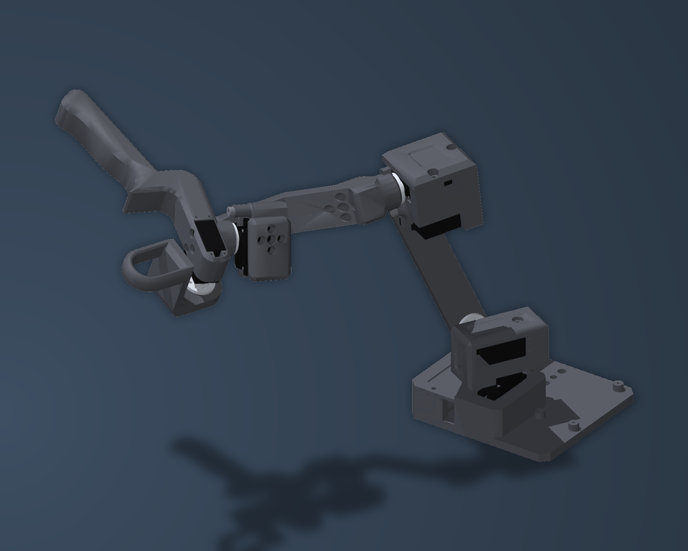

# Source Robotics robot descriptions

**URDF and MuJoCo models for PAR6, PAROL6, MSG and SSG48.**

Use a complete robot with your choice of end effector, or a standalone gripper
with either jaw option. Each model package includes its meshes, materials,
collision geometry, joints and mass properties, ready to open without a CAD build.

[](https://github.com/Source-Robotics/robot_descriptions/actions/workflows/models.yml)

[**Downloads**](#downloads) · [**Quick start**](#quick-start) · [**Change colors**](#customize) · [**Documentation**](docs/README.md) · [**Folder map**](REPOSITORY_GUIDE.md)

## Meet the models

| **[PAR6](guides/par6.md)** | **[PAROL6](guides/parol6.md)** |
| :---: | :---: |
|  |  |
| Six end-effector configurations | Six end-effector configurations |
| **[MSG gripper](guides/msg.md)** | **[SSG48 gripper](guides/ssg48.md)** |
|  |  |
| Solid jaws · Soft TPU jaws | Solid jaws · Fin-ray jaws |
| **[RAFT leader arm](guides/raft.md)** | |
|  | |
| Teleoperation leader for PAR6, with a trigger | |

Both arms support **Flange only**, **MSG / Solid jaws**, **MSG / Soft TPU jaws**,
**SSG48 / Solid jaws**, **SSG48 / Fin-ray jaws** and **Pneumatic gripper**.
Standalone gripper downloads include both of that gripper's jaw options.
MSG and SSG48 default to Solid jaws.

## Downloads

Choose one complete package for your product and format. **No source build is
needed.** The product guides list every scene and URDF filename.

| Product guide | MuJoCo package | URDF package |
| --- | --- | --- |
| **[PAR6](guides/par6.md)** | [par6_mujoco.zip](https://github.com/Source-Robotics/robot_descriptions/releases/latest/download/par6_mujoco.zip) | [par6_urdf.zip](https://github.com/Source-Robotics/robot_descriptions/releases/latest/download/par6_urdf.zip) |
| **[PAROL6](guides/parol6.md)** | [parol6_mujoco.zip](https://github.com/Source-Robotics/robot_descriptions/releases/latest/download/parol6_mujoco.zip) | [parol6_urdf.zip](https://github.com/Source-Robotics/robot_descriptions/releases/latest/download/parol6_urdf.zip) |
| **[MSG — gripper only](guides/msg.md)** | [msg_mujoco.zip](https://github.com/Source-Robotics/robot_descriptions/releases/latest/download/msg_mujoco.zip) | [msg_urdf.zip](https://github.com/Source-Robotics/robot_descriptions/releases/latest/download/msg_urdf.zip) |
| **[SSG48 — gripper only](guides/ssg48.md)** | [ssg48_mujoco.zip](https://github.com/Source-Robotics/robot_descriptions/releases/latest/download/ssg48_mujoco.zip) | [ssg48_urdf.zip](https://github.com/Source-Robotics/robot_descriptions/releases/latest/download/ssg48_urdf.zip) |
| **[RAFT — leader arm](guides/raft.md)** | [raft_mujoco.zip](https://github.com/Source-Robotics/robot_descriptions/releases/latest/download/raft_mujoco.zip) | [raft_urdf.zip](https://github.com/Source-Robotics/robot_descriptions/releases/latest/download/raft_urdf.zip) |

The [latest release](https://github.com/Source-Robotics/robot_descriptions/releases/latest)
also includes the dimensioned review PDF, checksums and optional MoveIt packages.
Use a [versioned release](https://github.com/Source-Robotics/robot_descriptions/releases)
when you need to pin a model for your project.

## Quick start

1. **Download** the ZIP for your product and format.
2. **Extract** it and keep the entire extracted folder together, including assets.
3. **Open** a viewer scene for MuJoCo or a model file for URDF.

**MuJoCo example:** with the Python `mujoco` package installed, extract
`par6_mujoco.zip` and run this from the directory containing the extracted `par6/` folder:

```bash
python -m mujoco.viewer --mjcf=par6/scene_msg.xml
```

This opens PAR6 with MSG Solid jaws. Choose another `scene_*.xml` to change
the end effector. From a source checkout, use
`--mjcf=mujoco/par6/scene_msg.xml` instead.

**URDF example:** extract `par6_urdf.zip` and open
`par6_description/par6_msg.urdf` in a URDF viewer. Keep `meshes/` alongside the
URDF. If a web viewer requests a folder or ZIP, provide that complete URDF package.

The [PAR6](guides/par6.md), [PAROL6](guides/parol6.md), [MSG](guides/msg.md) and
[SSG48](guides/ssg48.md) guides cover the other entry files and gripper controls.

<details>
<summary><strong>Using ROS 2, RViz or MoveIt?</strong></summary>

All five URDF packages install with colcon and provide RViz views and joint
sliders. Follow the [ROS 2 setup guide](docs/ROS2.md) for Humble or Jazzy, then run:

```bash
ros2 launch par6_description display.launch.py end_effector:=msg jaws:=soft_tpu
```

For TCP planning and mock trajectory execution, install the arm's matching
URDF and MoveIt configuration packages **from the same release**:

- [par6_moveit_config.zip](https://github.com/Source-Robotics/robot_descriptions/releases/latest/download/par6_moveit_config.zip)
- [parol6_moveit_config.zip](https://github.com/Source-Robotics/robot_descriptions/releases/latest/download/parol6_moveit_config.zip)

Follow the [MoveIt walkthrough](docs/MOVEIT2.md), then for example:

```bash
ros2 launch par6_moveit_config demo.launch.py end_effector:=msg jaws:=soft_tpu
```

Both arms support all six tools. These demos use mock controllers; the guide
explains the scope and the separate hardware integration. ROS 1 display entry
points remain available in the URDF packages.

</details>

## Customize

Change motor, gearbox, jaw, camera-lens and badge colors in one shared file:
[`source/appearance/colors.json`](source/appearance/colors.json).
The [illustrated color guide](docs/COLORS.md) walks through palette changes,
individual-part overrides and rebuilding both formats.

For geometry or model-data changes, use the [build guide](docs/maintenance/BUILDING.md)
and [authoring tools index](tools/README.md). The authoring workflow uses the
inputs included in this repository.

## Explore the model data

| What you want to check | Start here |
| --- | --- |
| Dimensions, joint frames and DH tables | [Review booklet: both arms with all six tools](docs/kinematics/robot_kinematics_review.pdf) · [PAR6 / PAROL6 comparison](reports/kinematics/par6_parol6_kinematics.md) |
| Measured properties and remaining estimates | [Current model status](docs/MODEL_STATUS.md) · [Mass, COM and inertia comparison](reports/dynamics/dynamics_sync_validation.md) |
| Jaw contacts and grasp fixtures | [Gripper reports](reports/grippers/README.md) |
| Views from MSG's built-in camera | [Camera previews and rendering example](docs/MSG_CAMERA.md) |
| What each folder contains | [Repository folder map](REPOSITORY_GUIDE.md) |
| Release history or an older model migration | [Changelog](CHANGELOG.md) · [Migration guide](guides/legacy-models.md) |

**Model accuracy:** arm mass properties use the captured RCB reference, and
measured electric-gripper masses are applied. Joint travel limits and some
actuation, tool COM/inertia and pneumatic data still need confirmation; see
the [model-status page](docs/MODEL_STATUS.md). TPU and Fin-ray jaws use rigid
geometry. Simulated grasp checks do not establish hardware grip force.

## Related product repositories

[PAR6](https://github.com/Source-Robotics/PAR6-Collaborative-Robot-Arm/tree/main/par6_description) ·
[PAROL6](https://github.com/Source-Robotics/PAROL6-Desktop-robot-arm/tree/main/parol6_description) ·
[MSG](https://github.com/Source-Robotics/MSG-compliant-AI-stepper-gripper/tree/main/msg_description) ·
[SSG48](https://github.com/Source-Robotics/SSG-48-adaptive-electric-gripper/tree/main/ssg48_description)

Their description folders contain product guides, previews and download links.
All maintained model files live here. Software projects can pin this repository;
see [integration and release maintenance](docs/maintenance/RELEASING.md).

## Community

Ask in [Discussions](https://github.com/orgs/Source-Robotics/discussions), chat on
[Discord](https://discord.com/invite/prjUvjmGpZ), report a model problem in
[Issues](https://github.com/Source-Robotics/robot_descriptions/issues). Follow Source Robotics:

[](https://discord.com/invite/prjUvjmGpZ)
[](https://github.com/orgs/Source-Robotics/discussions)
[](https://www.youtube.com/@source-robotics)
[](https://www.instagram.com/source_robotics/)
[](https://x.com/SourceRobotics)
[](https://www.linkedin.com/company/source-robotics/)
[](https://source-robotics.com/blogs/blog)

## Licensing

Models, meshes, artwork and documentation: **[CC BY 4.0](LICENSE)**.
Authoring tools and ROS support code: **[Apache-2.0](LICENSES/Apache-2.0.txt)**.
See [attribution and license scope](ATTRIBUTION.md) for credit details and
historical release licenses.
