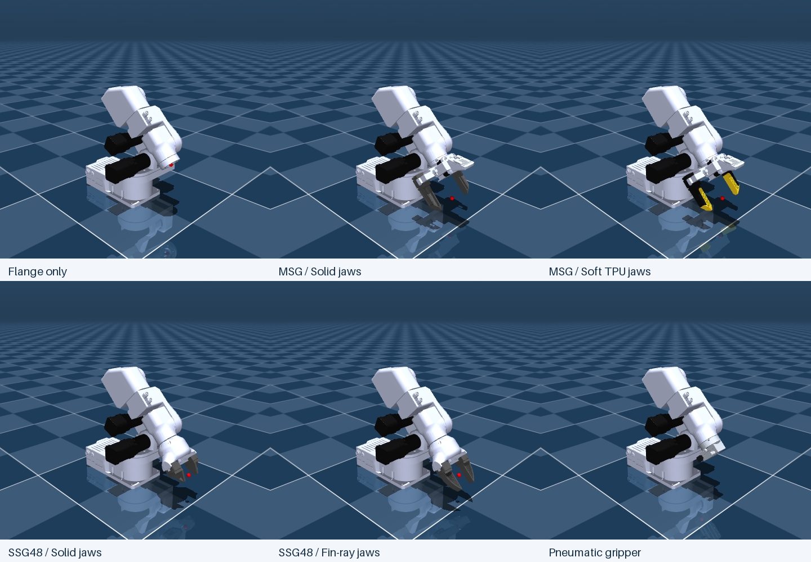

# Source Robotics robot descriptions

Ready-to-use **URDF and MuJoCo models for PAR6, PAROL6, MSG and SSG48**.
The grippers are available on their own or mounted on either robot. Robot
packages also include flange-only and pneumatic configurations. Meshes,
materials, collision geometry, joints and physical properties are included.

**Start here:** choose your robot or gripper below, then follow its download and
opening instructions. You do not need to build the models from source.

**Browse:** [Documentation](docs/README.md) · [Current model status](docs/MODEL_STATUS.md) ·
[Folder map](REPOSITORY_GUIDE.md)

## Choose your model

| Model | Getting started | Available configurations |
| --- | --- | --- |
| **PAR6** | [PAR6 guide](guides/par6.md) | All six end-effector configurations, URDF and MuJoCo |
| **PAROL6** | [PAROL6 guide](guides/parol6.md) | All six end-effector configurations, URDF and MuJoCo |
| **MSG gripper** | [MSG guide](guides/msg.md) | Solid jaws (default), Soft TPU jaws; standalone or mounted |
| **SSG48 gripper** | [SSG48 guide](guides/ssg48.md) | Solid jaws (default), Fin-ray jaws; standalone or mounted |



## Download a ready-to-use package

| Robot / gripper | MuJoCo | URDF |
| --- | --- | --- |
| PAR6 | [par6_mujoco.zip](https://github.com/Source-Robotics/robot_descriptions/releases/latest/download/par6_mujoco.zip) | [par6_urdf.zip](https://github.com/Source-Robotics/robot_descriptions/releases/latest/download/par6_urdf.zip) |
| PAROL6 | [parol6_mujoco.zip](https://github.com/Source-Robotics/robot_descriptions/releases/latest/download/parol6_mujoco.zip) | [parol6_urdf.zip](https://github.com/Source-Robotics/robot_descriptions/releases/latest/download/parol6_urdf.zip) |
| MSG (gripper only) | [msg_mujoco.zip](https://github.com/Source-Robotics/robot_descriptions/releases/latest/download/msg_mujoco.zip) | [msg_urdf.zip](https://github.com/Source-Robotics/robot_descriptions/releases/latest/download/msg_urdf.zip) |
| SSG48 (gripper only) | [ssg48_mujoco.zip](https://github.com/Source-Robotics/robot_descriptions/releases/latest/download/ssg48_mujoco.zip) | [ssg48_urdf.zip](https://github.com/Source-Robotics/robot_descriptions/releases/latest/download/ssg48_urdf.zip) |

1. Download the ZIP for your robot or gripper and simulator from the table.
2. Extract it and keep the whole extracted folder together.
3. Open a `scene_*.xml` file for MuJoCo, or a `par6_*.urdf`, `parol6_*.urdf`, `msg_*.urdf` or `ssg48_*.urdf`
   file for a URDF viewer. The robot guides list the exact files for every option.

The [release page](https://github.com/Source-Robotics/robot_descriptions/releases/latest)
also includes the dimensioned review PDF and checksums. For an online viewer,
upload one extracted model package, including its meshes/textures, rather than
this entire authoring repository. The source checkout contains the same models
under [`mujoco/`](mujoco) and [`urdf/`](urdf).

There are **eight independent packages**: PAR6, PAROL6, MSG and SSG48, each
in URDF and MuJoCo. The MSG/SSG48 downloads contain only the gripper and both
of its jaw options. The robot downloads include all six mounted end-effectors.
Choose a gripper guide below if you are working without an arm.

## ROS 2 and RViz

All four URDF packages provide native ROS 2 installation, saved RViz views and
joint sliders. Follow the [ROS 2 installation and display guide](docs/ROS2.md)
for Humble or Jazzy, then for example:

```bash
ros2 launch par6_description display.launch.py end_effector:=msg jaws:=soft_tpu
ros2 launch ssg48_description display.launch.py jaws:=fin_ray
```

Run one display at a time. Downloaded URDF packages install directly with colcon;
the CAD/authoring build is not needed. ROS 1 entry points remain available.

## Plan movements with MoveIt 2

PAR6 and PAROL6 have separate MoveIt 2 configuration packages for all six tool
options. Follow the [MoveIt installation and RViz walkthrough](docs/MOVEIT2.md)
to plan TCP movements, check collisions, open/close grippers and execute
trajectories with mock controllers:

```bash
ros2 launch par6_moveit_config demo.launch.py end_effector:=msg jaws:=soft_tpu
ros2 launch parol6_moveit_config demo.launch.py end_effector:=ssg48 jaws:=fin_ray
```

Download [par6_moveit_config.zip](https://github.com/Source-Robotics/robot_descriptions/releases/latest/download/par6_moveit_config.zip)
or [parol6_moveit_config.zip](https://github.com/Source-Robotics/robot_descriptions/releases/latest/download/parol6_moveit_config.zip)
**plus the matching URDF ZIP from the same release**. These two additional
configuration packages use the maintained description assets directly.
Mock execution follows commands ideally; hardware control and contact/dynamics
simulation are separate integrations.

## End-effector options

| Configuration | File suffix | Notes |
| --- | --- | --- |
| Flange only | `flange` | Physical mounting flange and TCP |
| MSG - Solid jaws | `msg` | Default MSG jaws; includes camera frames |
| MSG - Soft TPU jaws | `msg_tpu_glue` | Yellow honeycomb inserts and black holders |
| SSG48 - Solid jaws | `ssg48` | Default SSG48 jaws |
| SSG48 - Fin-ray jaws | `ssg48_stock` | Alternate SSG48 jaws |
| Pneumatic gripper | `pneumatic` | Two moving jaws, 3.5 mm travel per jaw |

The descriptive jaw names above are the public names. Existing file suffixes are
kept for compatibility. TPU and Fin-ray jaws are currently simulated as rigid
geometry; deformation is not modeled.

## Dimensions, DH tables and physical data

- [Dimensioned review booklet](docs/kinematics/robot_kinematics_review.pdf): all twelve robot/tool configurations.
- [PAR6 / PAROL6 kinematic comparison](reports/kinematics/par6_parol6_kinematics.md): axes, DH tables and wrist dimensions.
- [Mass and inertia status](reports/dynamics/dynamics_sync_validation.md): measured masses, RCB references and remaining estimates.
- [SSG48 collision and grasp checks](reports/grippers/ssg48_contact_diagnosis.md): jaw contacts and validation fixtures.
- [MSG built-in camera](docs/MSG_CAMERA.md): simulated views with both jaw options and a rendering example.

Robot packages include `docs/DH.md`, `docs/DYNAMICS.md`, `docs/ACTUATION.md` and
`docs/KINEMATIC_REVIEW.md`. Standalone gripper packages include their operating
instructions and `docs/VALIDATION.md`. Use those documents when integrating a model with a
controller. Tool COM/inertia, rotor inertia and some actuation parameters remain
estimates; simulation grip checks do not establish hardware grip force.

## Product guides in the hardware repositories

Open the product-specific folder in its hardware repository:

| Product | Guide folder |
| --- | --- |
| PAR6 | [par6_description/](https://github.com/Source-Robotics/PAR6-Collaborative-Robot-Arm/tree/main/par6_description) |
| PAROL6 | [parol6_description/](https://github.com/Source-Robotics/PAROL6-Desktop-robot-arm/tree/main/parol6_description) |
| MSG | [msg_description/](https://github.com/Source-Robotics/MSG-compliant-AI-stepper-gripper/tree/main/msg_description) |
| SSG48 | [ssg48_description/](https://github.com/Source-Robotics/SSG-48-adaptive-electric-gripper/tree/main/ssg48_description) |

Each contains a README, local previews and model download links. Hardware
repositories do not include the model source or a descriptions submodule.
Download and extract a model ZIP into your working directory to use it.
All maintained model files live in this central repository.

Software projects that load models directly from their checkout can pin this
repository as a submodule. See [release and integration maintenance](docs/maintenance/RELEASING.md).

## Build or customize

Change [`source/appearance/colors.json`](source/appearance/colors.json) to recolor
both robots and standalone grippers in URDF and MuJoCo from one palette.
See the [color and appearance guide](docs/COLORS.md) for illustrated motor, jaw
and badge examples, individual-part overrides and the build command.

The exported packages work independently. To regenerate them, change jaw colors,
edit branding, or contribute a model, see the [build guide](docs/maintenance/BUILDING.md),
[model details and authoring notes](docs/maintenance/MODEL_DETAILS.md), and [changelog](CHANGELOG.md).
The build uses only the files in this repository.

**Wondering what all the folders and files are?** Read the
[repository guide](REPOSITORY_GUIDE.md) for the package layout, editable inputs,
build tools, reports and generated files. Most users only need one model package.

## License

The models, meshes, artwork and documentation are licensed under
**[CC BY 4.0](LICENSE)**. Credit Source Robotics, link the source/license and
indicate changes when sharing. See [attribution and license scope](ATTRIBUTION.md).

Authoring tools and ROS support code remain
[Apache-2.0](LICENSES/Apache-2.0.txt). Releases through v2.14.0 retain their
original licenses. Hardware, firmware and external dependencies keep their own licenses.
