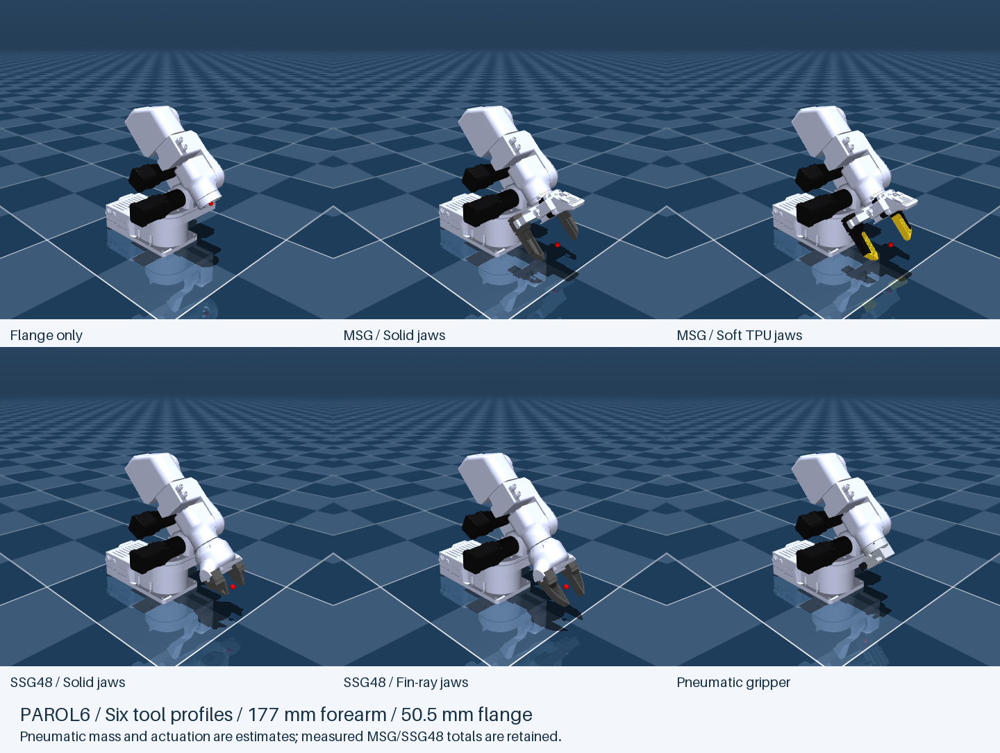

# Source Robotics robot descriptions

Ready-to-use **URDF and MuJoCo models for PAR6, PAROL6, MSG and SSG48**.
The grippers are available on their own or mounted on either robot. Robot
packages also include flange-only and pneumatic configurations. Meshes,
materials, collision geometry, joints and physical properties are included.

**Start here:** choose your robot or gripper below, then follow its download and
opening instructions. You do not need to build the models from source.

## Choose your model

| Model | Getting started | Available configurations |
| --- | --- | --- |
| **PAR6** | [PAR6 guide](guides/par6.md) | All six end-effector configurations, URDF and MuJoCo |
| **PAROL6** | [PAROL6 guide](guides/parol6.md) | All six end-effector configurations, URDF and MuJoCo |
| **MSG gripper** | [MSG guide](guides/msg.md) | Solid jaws (default), Soft TPU jaws; standalone or mounted |
| **SSG48 gripper** | [SSG48 guide](guides/ssg48.md) | Solid jaws (default), Fin-ray jaws; standalone or mounted |

## Download a ready-to-use package

| Robot / gripper | MuJoCo | URDF |
| --- | --- | --- |
| PAR6 | [par6_mujoco.zip](https://github.com/Source-Robotics/robot_descriptions/releases/latest/download/par6_mujoco.zip) | [par6_urdf.zip](https://github.com/Source-Robotics/robot_descriptions/releases/latest/download/par6_urdf.zip) |
| PAROL6 | [parol6_mujoco.zip](https://github.com/Source-Robotics/robot_descriptions/releases/latest/download/parol6_mujoco.zip) | [parol6_urdf.zip](https://github.com/Source-Robotics/robot_descriptions/releases/latest/download/parol6_urdf.zip) |
| MSG (gripper only) | [msg_mujoco.zip](https://github.com/Source-Robotics/robot_descriptions/releases/latest/download/msg_mujoco.zip) | [msg_urdf.zip](https://github.com/Source-Robotics/robot_descriptions/releases/latest/download/msg_urdf.zip) |
| SSG48 (gripper only) | [ssg48_mujoco.zip](https://github.com/Source-Robotics/robot_descriptions/releases/latest/download/ssg48_mujoco.zip) | [ssg48_urdf.zip](https://github.com/Source-Robotics/robot_descriptions/releases/latest/download/ssg48_urdf.zip) |

1. Download the ZIP for your robot or gripper and simulator from the table.
2. Extract it and keep the whole extracted folder together.
3. Open a `scene_*.xml` file for MuJoCo, or a `par6_*.urdf`, `parol6_*.urdf`, `msg_*.urdf` or `ssg48_*.urdf`
   file for a URDF viewer. The robot guides list the exact files for every option.

The [release page](https://github.com/Source-Robotics/robot_descriptions/releases/latest)
also includes the dimensioned review PDF and checksums. For an online viewer,
upload one extracted model package, including its meshes/textures, rather than
this entire authoring repository. The source checkout contains the same models
under [`mujoco/`](mujoco/) and [`urdf/`](urdf/).

There are **eight independent packages**: PAR6, PAROL6, MSG and SSG48, each
in URDF and MuJoCo. The MSG/SSG48 downloads contain only the gripper and both
of its jaw options. The robot downloads include all six mounted end-effectors.
Choose a gripper guide below if you are working without an arm.

## End-effector options

| Configuration | File suffix | Notes |
| --- | --- | --- |
| Flange only | `flange` | Physical mounting flange and TCP |
| MSG - Solid jaws | `msg` | Default MSG jaws; includes camera frames |
| MSG - Soft TPU jaws | `msg_tpu_glue` | Yellow honeycomb inserts and black holders |
| SSG48 - Solid jaws | `ssg48` | Default SSG48 jaws |
| SSG48 - Fin-ray jaws | `ssg48_stock` | Alternate SSG48 jaws |
| Pneumatic gripper | `pneumatic` | Two moving jaws, 3.5 mm travel per jaw |

The descriptive jaw names above are the public names. Existing file suffixes are
kept for compatibility. TPU and Fin-ray jaws are currently simulated as rigid
geometry; deformation is not modeled.

## Dimensions, DH tables and physical data

- [Dimensioned review booklet](output/pdf/robot_kinematics_review.pdf): all twelve robot/tool configurations.
- [PAR6 / PAROL6 kinematic comparison](reports/par6_parol6_kinematics.md): axes, DH tables and wrist dimensions.
- [Mass and inertia status](reports/dynamics_sync_validation.md): measured masses, RCB references and remaining estimates.
- [SSG48 collision and grasp checks](reports/ssg48_contact_diagnosis.md): jaw contacts and validation fixtures.

Robot packages include `DH.md`, `DYNAMICS.md`, `ACTUATION.md` and
`KINEMATIC_REVIEW.md`. Standalone gripper packages include their operating
instructions and `VALIDATION.md`. Use those documents when integrating a model with a
controller. Tool COM/inertia, rotor inertia and some actuation parameters remain
estimates; simulation grip checks do not establish hardware grip force.

## Product guides in the hardware repositories

Open the product-specific folder in its hardware repository:

| Product | Guide folder |
| --- | --- |
| PAR6 | [par6_description/](https://github.com/Source-Robotics/PAR6-Collaborative-Robot-Arm/tree/main/par6_description) |
| PAROL6 | [parol6_description/](https://github.com/Source-Robotics/PAROL6-Desktop-robot-arm/tree/main/parol6_description) |
| MSG | [msg_description/](https://github.com/Source-Robotics/MSG-compliant-AI-stepper-gripper/tree/main/msg_description) |
| SSG48 | [ssg48_description/](https://github.com/Source-Robotics/SSG-48-adaptive-electric-gripper/tree/main/ssg48_description) |

Each contains a README, local previews and model download links. Hardware
repositories do not include the model source or a descriptions submodule.
Download and extract a model ZIP into your working directory to use it.
All maintained model files live in this central repository.

Software projects that load models directly from their checkout can pin this
repository as a submodule. See [release and integration maintenance](RELEASING.md).

## Build or customize

The exported packages work independently. To regenerate them, change jaw colors,
edit branding, or contribute a model, see the [build guide](BUILDING.md),
[model details and authoring notes](MODEL_DETAILS.md), and [changelog](CHANGELOG.md).
The build uses only the files in this repository.

## License

The description packages are provided under [Apache-2.0](LICENSE). Hardware,
firmware and other projects linked from this repository retain their own licenses.
