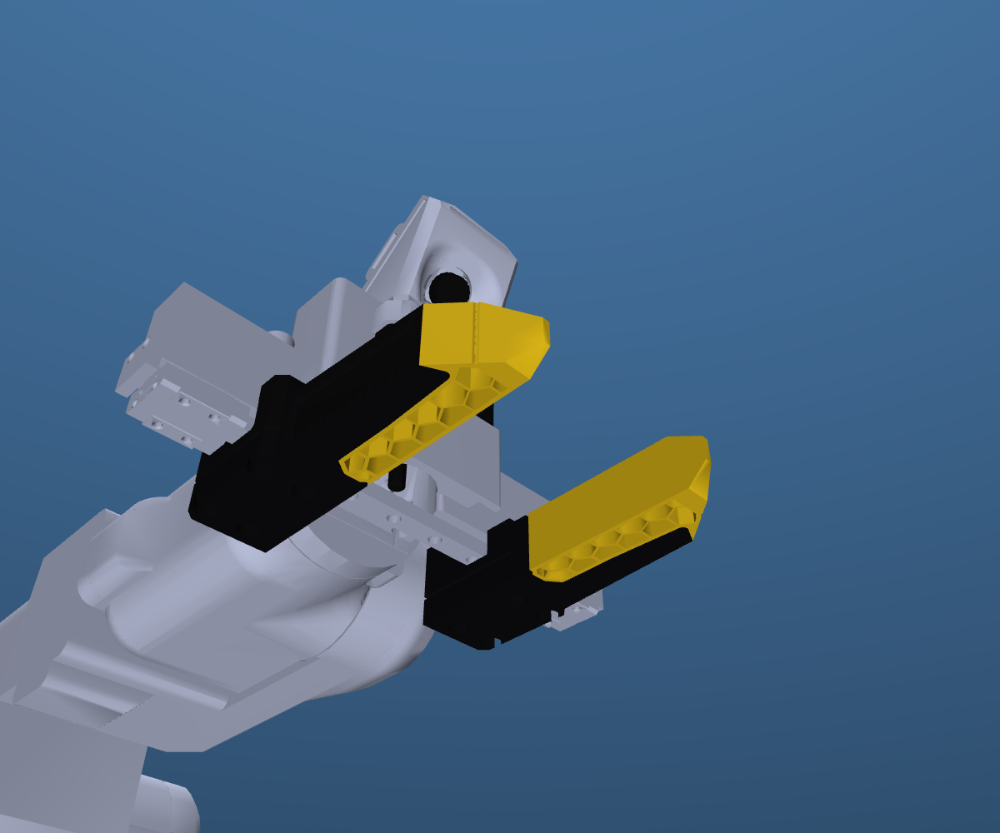

# MSG gripper models

[All models](../README.md) | [PAR6 guide](par6.md) | [PAROL6 guide](parol6.md)

Choose **Solid jaws** (default) or **Soft TPU jaws**. Both options are available
mounted on PAR6 and PAROL6, in URDF and native MuJoCo formats.

## Use the gripper on a robot

1. Choose [PAR6](par6.md) or [PAROL6](parol6.md).
2. Download that robot's MuJoCo or URDF ZIP using its guide.
3. Open the entry file for your jaw option:

| Jaws | Robot | MuJoCo entry file | URDF entry file |
| --- | --- | --- | --- |
| Solid jaws (default) | PAR6 | [`scene_msg.xml`](../mujoco/par6/scene_msg.xml) | [`par6_msg.urdf`](../urdf/par6_description/par6_msg.urdf) |
| Solid jaws (default) | PAROL6 | [`scene_msg.xml`](../mujoco/parol6/scene_msg.xml) | [`parol6_msg.urdf`](../urdf/parol6_description/parol6_msg.urdf) |
| Soft TPU jaws | PAR6 | [`scene_msg_tpu_glue.xml`](../mujoco/par6/scene_msg_tpu_glue.xml) | [`par6_msg_tpu_glue.urdf`](../urdf/par6_description/par6_msg_tpu_glue.urdf) |
| Soft TPU jaws | PAROL6 | [`scene_msg_tpu_glue.xml`](../mujoco/parol6/scene_msg_tpu_glue.xml) | [`parol6_msg_tpu_glue.urdf`](../urdf/parol6_description/parol6_msg_tpu_glue.urdf) |

If you cloned the MSG hardware repository with its descriptions submodule,
these files are under `models/descriptions/mujoco/` and
`models/descriptions/urdf/`. The complete mesh folders must stay with them.

## Use a gripper without an arm

The current shared release contains complete robot assemblies, rather than
dedicated gripper-only URDF/MuJoCo packages. Its MuJoCo packages also include
[`bench/`](../mujoco/par6/bench/README.md) fixtures that isolate each electric
gripper for box/cylinder grasp checks. Those fixtures include a test object,
table and a prescribed-motion mount; they are validation scenes.

The older [standalone MSG exports](https://github.com/Source-Robotics/MSG-compliant-AI-stepper-gripper/tree/main/MSG_gripper_description)
are retained in the hardware repository for existing gripper-only integrations.
They predate the shared jaw/color/mass/contact updates and do not include all
the current options. Use the shared mounted models for the current model data.

## What changes when selecting jaws?

The selected visual and external collision geometry changes. Joint travel,
coupling, configured TCP and the measured moving-assembly mass are retained.
The MSG complete mass used here is 380 g;
each moving finger/jaw assembly is 39.3 g. Tool COM and inertia remain estimates.
Soft-material deformation is not simulated.

See [physical-data status](../mujoco/par6/DYNAMICS.md),
[contact validation](../reports/ssg48_contact_diagnosis.md), and
[jaw source/customization notes](../MODEL_DETAILS.md#rebuilding-jaws).
The existing control TCP is not a measured jaw-specific grasp center.
