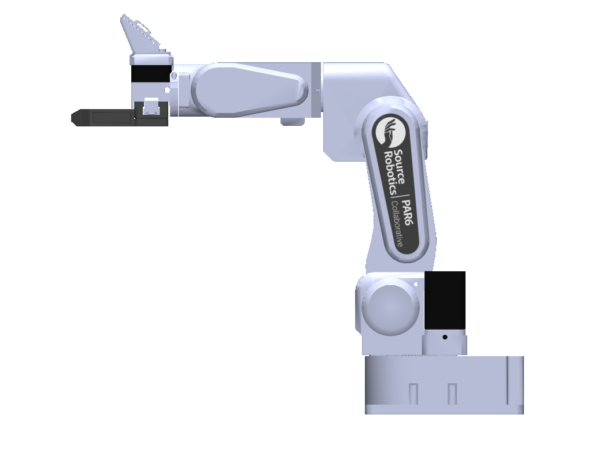
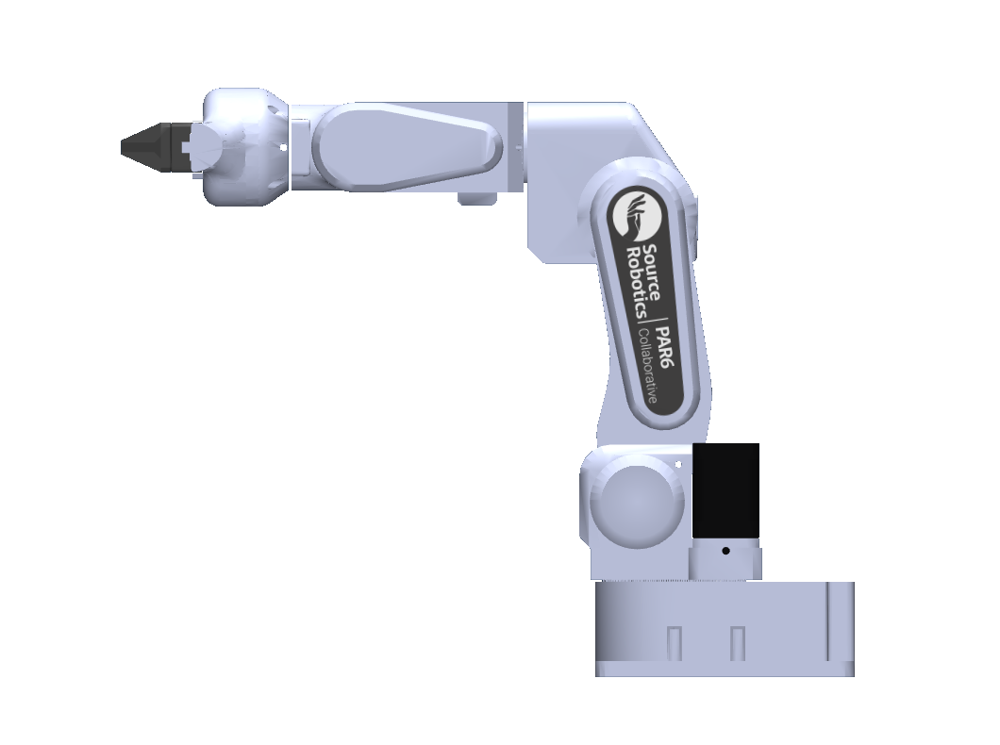

# PAR6 models: getting started

[All models](../README.md) | [MSG jaws](msg.md) | [SSG48 jaws](ssg48.md) | [Change colors](../docs/COLORS.md) | [License and attribution](../ATTRIBUTION.md)

PAR6 is available in **MuJoCo and URDF**, with all six configurations below.
The default `scene.xml` in the MuJoCo package opens the MSG with Solid jaws.

### PAR6 with MSG



### PAR6 with SSG48



## 1. Download

- **MuJoCo:** [download par6_mujoco.zip](https://github.com/Source-Robotics/robot_descriptions/releases/latest/download/par6_mujoco.zip), then extract the `par6/` folder.
- **URDF:** [download par6_urdf.zip](https://github.com/Source-Robotics/robot_descriptions/releases/latest/download/par6_urdf.zip), then extract the `par6_description/` folder.

Keep each extracted folder intact; the model files use relative paths to meshes
and textures. No CAD tools or source build are needed to use these downloads.

## 2. Choose an end effector

| End effector | MuJoCo entry file | URDF entry file |
| --- | --- | --- |
| Flange only | [`scene_flange.xml`](../mujoco/par6/scene_flange.xml) | [`par6_flange.urdf`](../urdf/par6_description/par6_flange.urdf) |
| MSG - Solid jaws (default) | [`scene_msg.xml`](../mujoco/par6/scene_msg.xml) | [`par6_msg.urdf`](../urdf/par6_description/par6_msg.urdf) |
| MSG - Soft TPU jaws | [`scene_msg_tpu_glue.xml`](../mujoco/par6/scene_msg_tpu_glue.xml) | [`par6_msg_tpu_glue.urdf`](../urdf/par6_description/par6_msg_tpu_glue.urdf) |
| SSG48 - Solid jaws (default) | [`scene_ssg48.xml`](../mujoco/par6/scene_ssg48.xml) | [`par6_ssg48.urdf`](../urdf/par6_description/par6_ssg48.urdf) |
| SSG48 - Fin-ray jaws | [`scene_ssg48_stock.xml`](../mujoco/par6/scene_ssg48_stock.xml) | [`par6_ssg48_stock.urdf`](../urdf/par6_description/par6_ssg48_stock.urdf) |
| Pneumatic gripper | [`scene_pneumatic.xml`](../mujoco/par6/scene_pneumatic.xml) | [`par6_pneumatic.urdf`](../urdf/par6_description/par6_pneumatic.urdf) |

The links point to the source checkout. The downloaded packages contain the
same entry files. Each configuration includes the corresponding joints,
collision geometry, masses, materials and TCP frame.

## 3. Open the model

**MuJoCo:** open the selected `scene_*.xml` in your MuJoCo viewer. With the
Python MuJoCo package installed, this example runs from the directory where you
extracted the ZIP:

```bash
python -m mujoco.viewer --mjcf=par6/scene_msg.xml
```

For a checkout of the central `robot_descriptions` repository, run this
from its root:

```bash
python -m mujoco.viewer --mjcf=mujoco/par6/scene_msg.xml
```

The hardware repository's `par6_description/` folder contains this guide
and previews. Extract the model download into a separate working directory
or ROS workspace to use the actual model package.

**URDF viewer:** open `par6_description/par6_msg.urdf`, keeping the
`meshes/` directory alongside it. If a web viewer asks for a ZIP or folder,
provide this one URDF package with all its assets.

**ROS 1 / RViz:** place the extracted `par6_description` package in
`catkin_ws/src`, build and source that workspace, then run:

```bash
roslaunch par6_description display.launch end_effector:=msg
```

Replace `msg` with any file suffix in the table. The supplied launch files are
ROS 1 files; a ROS 2 consumer can use the URDF with its own launch setup.

## 4. Check dimensions and frames

For MSG configurations, see [the built-in camera view](../docs/MSG_CAMERA.md).

- [Dimensioned PAR6 review sheets](../mujoco/par6/docs/KINEMATIC_REVIEW.md)
- [PAR6 DH convention](../mujoco/par6/docs/DH.md)
- [PAR6 / PAROL6 comparison](../reports/par6_parol6_kinematics.md)
- [Mass, COM and inertia status](../mujoco/par6/docs/DYNAMICS.md)
- [Actuator settings](../mujoco/par6/docs/ACTUATION.md)
- [Pneumatic jaw motion and controls](../mujoco/par6/docs/PNEUMATIC.md)

`flange` is the physical tool-mounting face; `tcp` is the configured control
frame. Jaw-specific grasp centers have not been calibrated. PAR6 and PAROL6
share the public joint conventions and a 177 mm forearm; their shorter/longer
wrist housings require different flange offsets.

## Updating an older model

The shared repository replaces the older model folder in the PAR6 hardware
repository. File locations and some public joint names have changed. See the
[name migration table](../urdf/par6_description/docs/MIGRATION.md) and
[legacy-folder migration guide](legacy-models.md) before updating existing code.
