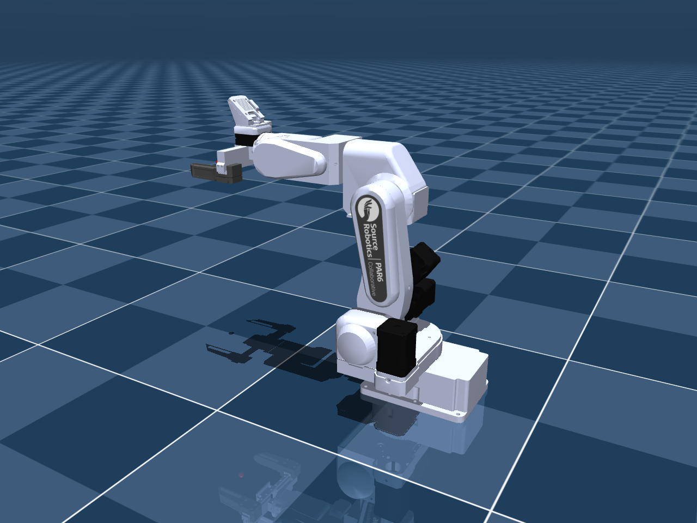

# Source Robotics PAR6: MuJoCo

Self-contained PAR6 package with all six end-effector configurations.
Keep this folder together so the model can find its meshes and textures.



## Choose a model

| Configuration | Viewer scene |
| --- | --- |
| Flange only | [`scene_flange.xml`](scene_flange.xml) |
| MSG - Solid jaws | [`scene_msg.xml`](scene_msg.xml) |
| MSG - Soft TPU jaws | [`scene_msg_tpu_glue.xml`](scene_msg_tpu_glue.xml) |
| SSG48 - Solid jaws | [`scene_ssg48.xml`](scene_ssg48.xml) |
| SSG48 - Fin-ray jaws | [`scene_ssg48_stock.xml`](scene_ssg48_stock.xml) |
| Pneumatic gripper | [`scene_pneumatic.xml`](scene_pneumatic.xml) |

MSG and SSG48 each default to Solid jaws. Alternate choices are MSG Soft TPU
and SSG48 Fin-ray jaws. TPU and Fin-ray deformation is not simulated.

From this package directory, run:

```bash
python -m mujoco.viewer --mjcf=scene_msg.xml
```

`scene.xml` also opens MSG Solid jaws. Use `par6_<option>.xml` when adding the robot to your own MuJoCo world.

## Package folders

| Folder | Contents |
| --- | --- |
| `assets/` | Geometry, textures and collision pieces. |
| [`docs/`](docs/) | DH tables, physical-data notes, actuation assumptions, contact checks and dimensioned review sheets. |
| [`previews/`](previews/) | Model preview images. |
| `bench/` | Eight electric-gripper grasp-test fixtures. |

The entry files, README, license and package metadata stay at the package root.

## Model data and dimensions

- [DH and joint conventions](docs/DH.md)
- [PAR6/PAROL6 comparison](docs/KINEMATICS_COMPARISON.md)
- [Dimensioned review sheets](docs/KINEMATIC_REVIEW.md)
- [Mass, COM and inertia status](docs/DYNAMICS.md)
- [Simulation actuation settings](docs/ACTUATION.md)
- [Pneumatic gripper](docs/PNEUMATIC.md)
- [Detailed appearance and jaw notes](docs/MODEL_DETAILS.md)

Measured tool masses are applied; tool COM/inertia, rotor inertia and some
actuation/contact parameters remain estimates. See the linked notes for scope.

Maintained in [robot_descriptions](https://github.com/Source-Robotics/robot_descriptions).
