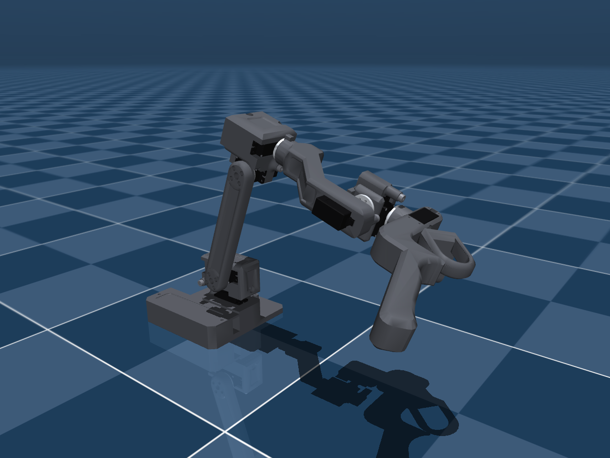

# Source Robotics RAFT: MuJoCo leader arm

This self-contained package contains the **RAFT teleoperation leader arm**: six joints like PAR6's at 5/9 scale,
the trigger on its handle, torque actuators and the optional J2 counterbalance spring. All required meshes and
materials are included. Keep the whole folder together when moving or uploading it.



| File | Use it for |
| --- | --- |
| `scene.xml` | Viewer scene: the arm with a floor and lighting. Open this for a quick look. |
| `raft.xml` | Native MJCF robot definition: bodies, joints, inertials, visuals, collisions, actuators and keyframes. Use this when integrating into another MuJoCo world. |

Detailed notes are in [docs/](docs/), model images in [previews/](previews/), and geometry in `assets/`
(`assets/visual/` holds the separately coloured printed parts, servos, horns and screws). The model entry files
remain at the package root.

## Open the model

After extracting the ZIP, run this from its parent directory:

```bash
python -m mujoco.viewer --mjcf=raft/scene.xml
```

## Joints, actuators and frames

| Bodies | Joints | Actuators |
| --- | --- | --- |
| `base_link`, `shoulder_link`, `upper_arm_link`, `forearm_link`, `wrist_1_link`, `wrist_2_link`, `wrist_3_link`, `trigger_link` | `base_joint`, `shoulder_joint`, `elbow_joint`, `wrist_1_joint`, `wrist_2_joint`, `wrist_3_joint`, `trigger_joint` | `<joint>_actuator` |

The actuators are `motor` actuators: `ctrl` is the joint torque in Nm, as RAFT's servos run in current mode
([actuation](docs/ACTUATION.md)). The site `tcp` is the tool point; the sensors `tcp_pos` and `tcp_quat` report it.
`qpos = 0` is the standby pose, PAR6's standby pose, so RAFT's joint angles map one to one onto PAR6's
([DH](docs/DH.md), [comparison](docs/KINEMATICS_COMPARISON.md)). Keyframes: `home` (all zero), `parked` (RAFT's
firmware rest pose), `handle_in_front`, `reach_forward` and `stretched`.

Visual geoms are group 2 and collision geoms, the complete link meshes, group 3. The tendon `j2_spring` models the
optional J2 counterbalance; its stiffness 0 means no spring is fitted.

## Physical properties and current limits

Complete arm mass: **371.3 g**; moving links and trigger: **283.5 g**. Masses, centres of mass
and inertias come from the CAD ([dynamics](docs/DYNAMICS.md)); the joint ranges from the measured mechanical stops
and a CAD sweep ([joint ranges](docs/JOINT_LIMITS.md)). The servos' friction, damping and rotor inertia are
estimates, not measurements.

The model is built from RAFT's reference export, the same source as the firmware's own model in the
[RAFT repository](https://github.com/Source-Robotics/RAFT-teleoperation-arm).

## License and attribution

Models and assets: **CC BY 4.0**. See [attribution and license scope](docs/ATTRIBUTION.md).

[Changing colors](docs/COLORS.md): shared palette, part overrides and illustrated examples.
