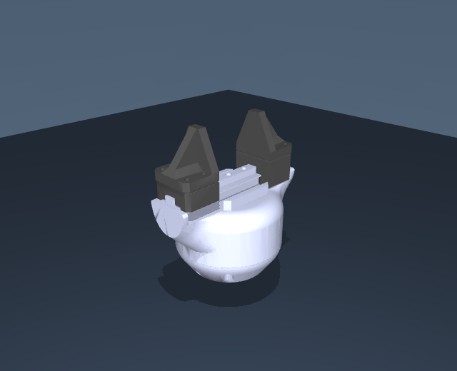

# Source Robotics SSG48: standalone MuJoCo gripper

This self-contained package contains **only the SSG48 gripper**, with both jaw
options, its fixed mounting frame and configured TCP. All required meshes and
materials are included. Keep the whole folder together when moving or uploading it.



| Jaws | Viewer scene | Gripper model |
| --- | --- | --- |
| Solid jaws (default) | `scene_solid.xml` | `ssg48_solid.xml` |
| Fin-ray jaws | `scene_fin_ray.xml` | `ssg48_fin_ray.xml` |

The default is Solid jaws. `scene.xml` is an alias for `scene_solid.xml`.

Detailed notes are in [docs/](docs/), model images in [previews/](previews/),
and geometry in `assets/`. The model entry files
remain at the package root.

## Open the model

After extracting the ZIP, run this from its parent directory:

```bash
python -m mujoco.viewer --mjcf=ssg48/scene_solid.xml
```

## Mount and finger controls

The fixed mount is `flange`. The native model has two coupled slide joints
and one position actuator, `gripper_actuator`. Control is in meters:
`0` opens; `-0.0235` closes. The `open` and `closed` keyframes
show those endpoints. Keep the joint equality enabled. To attach it to a moving
robot, mount the `flange` subtree in that robot rather than adding another arm.
The explicit housing/finger exclusions preserve the robot package's adjacent
body filtering when the standalone housing is fixed to world.


Each finger travels 23.5 mm. Both formats preserve their
corresponding arm-mounted tool's joint origins, axes, limits, coupling, collision
surfaces, materials, mass properties and TCP definition.
No arm, flange hardware, grasp object, table, mocap target or free joint is in
the gripper model itself. The optional viewer scene adds only lighting and floor.
`flange` is a massless frame; the 55.5 g robot flange is not part of this package.

## Physical properties and current limits

Complete gripper mass: **440 g**. Fixed assembly:
**361.4 g**; each complete moving assembly: **39.3 g**.
Tool COM and inertia remain the current unverified estimates. The two jaw
options share those measured mass targets; TPU/Fin-ray deformation is not
simulated. Actuation parameters and grip force are not hardware calibration.

The retained `tcp` is the operational control frame, not a newly measured
jaw-specific grasp center. Frame and inertia definitions are copied from the
maintained robot assembly; exporting does not infer new physical measurements.

See [validation notes](docs/VALIDATION.md) for the extraction checks and `LICENSE` for CC BY 4.0.

## License and attribution

Models and assets: **CC BY 4.0**. See [attribution and license scope](docs/ATTRIBUTION.md).

[Changing colors](docs/COLORS.md): material names, editable palettes and examples.
