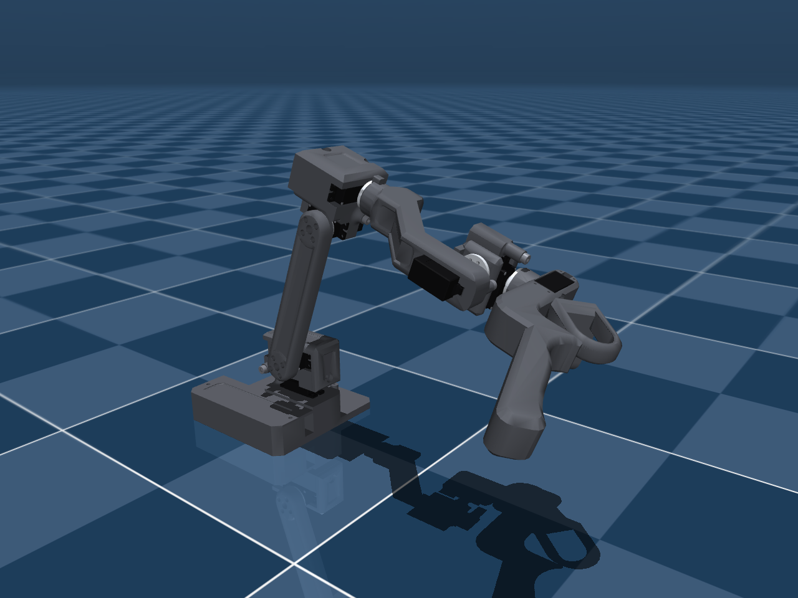

# Source Robotics RAFT: URDF leader arm

This self-contained package contains the **RAFT teleoperation leader arm**: six joints like PAR6's at 5/9 scale and
the trigger on its handle, with all meshes, materials, collision geometry and mass properties. Keep the whole folder
together when moving or uploading it.



| File | Use it for |
| --- | --- |
| `raft.urdf` | The arm: links, joints, ranges, inertials, coloured visual meshes and collision meshes. |

The URDF is at the package root and uses relative mesh paths. Detailed notes are in [docs/](docs/), model images in
[previews/](previews/), and geometry in `meshes/` (`meshes/visual/` holds the separately coloured printed parts,
servos, horns and screws).

## Open the model

Open `raft.urdf` in a viewer with `meshes/` alongside it, or install the package in a ROS 2 workspace using
[the ROS 2 guide](docs/ROS2.md), source the workspace and run:

```bash
ros2 launch raft_description display.launch.py
```

## Links, joints and frames

| Links | Joints |
| --- | --- |
| `base_link`, `shoulder_link`, `upper_arm_link`, `forearm_link`, `wrist_1_link`, `wrist_2_link`, `wrist_3_link`, `trigger_link`, `tcp` | `base_joint`, `shoulder_joint`, `elbow_joint`, `wrist_1_joint`, `wrist_2_joint`, `wrist_3_joint`, `trigger_joint`, `tcp_fixed_joint` |

`base_link` is the root link. `tcp` is the tool point, fixed to `wrist_3_link`. `q = 0` is the standby pose, PAR6's
standby pose, so RAFT's joint angles map one to one onto PAR6's ([DH](docs/DH.md),
[comparison](docs/KINEMATICS_COMPARISON.md)). Each joint's `effort` is the servo's stall torque and `<dynamics>`
carries the estimated damping and friction ([actuation](docs/ACTUATION.md)). URDF itself does not implement the
servos' current control; the native MuJoCo package has the torque actuators.

## Physical properties and current limits

Complete arm mass: **{{MASS_TOTAL}} g**; moving links and trigger: **{{MASS_MOVING}} g**. Masses, centres of mass
and inertias come from the CAD ([dynamics](docs/DYNAMICS.md)); the joint ranges from the measured mechanical stops
and a CAD sweep ([joint ranges](docs/JOINT_LIMITS.md)). The servos' friction, damping and rotor inertia are
estimates, not measurements.

The model is built from RAFT's reference export, the same source as the firmware's own model in the
[RAFT repository](https://github.com/Source-Robotics/RAFT-teleoperation-arm).
