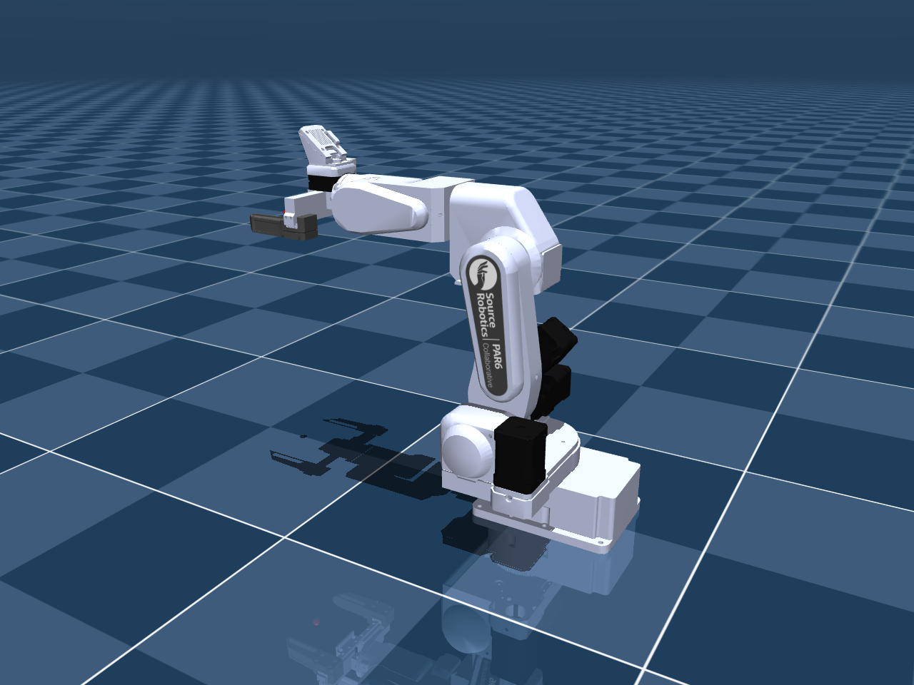

# Source Robotics PAR6: URDF

Self-contained PAR6 package with all six end-effector configurations.
Keep this folder together so the model can find its meshes and textures.



## Choose a model

| Configuration | URDF entry file |
| --- | --- |
| Flange only | [`par6_flange.urdf`](par6_flange.urdf) |
| MSG - Solid jaws | [`par6_msg.urdf`](par6_msg.urdf) |
| MSG - Soft TPU jaws | [`par6_msg_tpu_glue.urdf`](par6_msg_tpu_glue.urdf) |
| SSG48 - Solid jaws | [`par6_ssg48.urdf`](par6_ssg48.urdf) |
| SSG48 - Fin-ray jaws | [`par6_ssg48_stock.urdf`](par6_ssg48_stock.urdf) |
| Pneumatic gripper | [`par6_pneumatic.urdf`](par6_pneumatic.urdf) |

MSG and SSG48 each default to Solid jaws. Alternate choices are MSG Soft TPU
and SSG48 Fin-ray jaws. TPU and Fin-ray deformation is not simulated.

For native ROS 2, install this package with colcon using [the ROS 2 guide](docs/ROS2.md),
source the workspace, then run:

```bash
ros2 launch par6_description display.launch.py end_effector:=msg jaws:=solid
```

The launcher opens RViz and joint sliders. Select `jaws:=soft_tpu` for MSG Soft TPU
or `end_effector:=ssg48 jaws:=fin_ray` for SSG48 Fin-ray. ROS 1 retains
`roslaunch par6_description display.launch end_effector:=msg`. Other URDF viewers
can open a selected file directly with meshes/ alongside it.

## Package folders

| Folder | Contents |
| --- | --- |
| `meshes/` | Geometry, textures and collision pieces. |
| [`docs/`](docs/) | DH tables, physical-data notes, actuation assumptions, contact checks and dimensioned review sheets. |
| [`previews/`](previews/) | Model preview images. |
| `config/`, `launch/` | ROS joint configuration and launch files. |

The entry files, README, license and package metadata stay at the package root.

## Model data and dimensions

- [DH and joint conventions](docs/DH.md)
- [PAR6/PAROL6 comparison](docs/KINEMATICS_COMPARISON.md)
- [Dimensioned review sheets](docs/KINEMATIC_REVIEW.md)
- [Mass, COM and inertia status](docs/DYNAMICS.md)
- [Simulation actuation settings](docs/ACTUATION.md)
- [Pneumatic gripper](docs/PNEUMATIC.md)
- [Detailed appearance and jaw notes](docs/MODEL_DETAILS.md)

Measured tool masses are applied; tool COM/inertia, rotor inertia and some
actuation/contact parameters remain estimates. See the linked notes for scope.

Maintained in [robot_descriptions](https://github.com/Source-Robotics/robot_descriptions).

## License and attribution

Models and assets: **CC BY 4.0**. See [attribution and license scope](docs/ATTRIBUTION.md).

[Changing colors](docs/COLORS.md): shared palette, part overrides and illustrated examples.

[MSG built-in camera](docs/MSG_CAMERA.md): simulated views with both jaw options and a rendering example.

[MoveIt 2 planning](docs/MOVEIT2.md): install `par6_moveit_config` alongside this package for TCP planning and mock execution.
