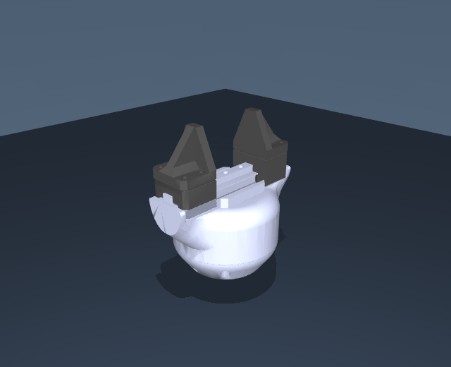

# Source Robotics SSG48: standalone URDF gripper

This self-contained package contains **only the SSG48 gripper**, with both jaw
options, its fixed mounting frame and configured TCP. All required meshes and
materials are included. Keep the whole folder together when moving or uploading it.



| Jaws | URDF entry file |
| --- | --- |
| Solid jaws (default) | `ssg48_solid.urdf` |
| Fin-ray jaws | `ssg48_fin_ray.urdf` |

The default is Solid jaws. The URDF filenames are at the package root and use relative mesh paths.

Detailed notes are in [docs/](docs/), model images in [previews/](previews/),
and geometry in `meshes/`. The model entry files
remain at the package root.

## Open the model

Open the selected URDF in a viewer with meshes/ alongside it, or install the package in a ROS 2 workspace using [the ROS 2 guide](docs/ROS2.md), source the workspace and run:

```bash
ros2 launch ssg48_description display.launch.py jaws:=solid
```

## Mount and finger controls

The URDF root link, `flange`, is the mounting face. Attach it to your robot
with a fixed joint. `left_finger_joint` drives the mechanism and
`right_finger_joint` follows its retained mimic relation. Your URDF consumer
must honor the mimic joint and exclude adjacent housing/finger collisions.
Native ROS 2 installation, RViz and slider instructions are in [ROS2.md](docs/ROS2.md).
The older `display.launch` remains available for ROS 1. URDF itself does not
implement the native MuJoCo position servo or contact solver.

Each finger travels 23.5 mm. Both formats preserve their
corresponding arm-mounted tool's joint origins, axes, limits, coupling, collision
surfaces, materials, mass properties and TCP definition.
No arm, flange hardware, grasp object, table, mocap target or free joint is in
the gripper model itself. The optional viewer scene adds only lighting and floor.
`flange` is a massless frame; the 55.5 g robot flange is not part of this package.

## Physical properties and current limits

Complete gripper mass: **440 g**. Fixed assembly:
**361.4 g**; each complete moving assembly: **39.3 g**.
Tool COM and inertia remain the current unverified estimates. The two jaw
options share those measured mass targets; TPU/Fin-ray deformation is not
simulated. Actuation parameters and grip force are not hardware calibration.

The retained `tcp` is the operational control frame, not a newly measured
jaw-specific grasp center. Frame and inertia definitions are copied from the
maintained robot assembly; exporting does not infer new physical measurements.

See [validation notes](docs/VALIDATION.md) for the extraction checks and `LICENSE` for CC BY 4.0.

## License and attribution

Models and assets: **CC BY 4.0**. See [attribution and license scope](docs/ATTRIBUTION.md).

[Changing colors](docs/COLORS.md): shared palette, part overrides and illustrated examples.
